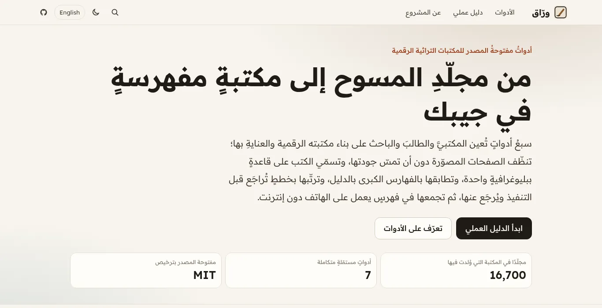
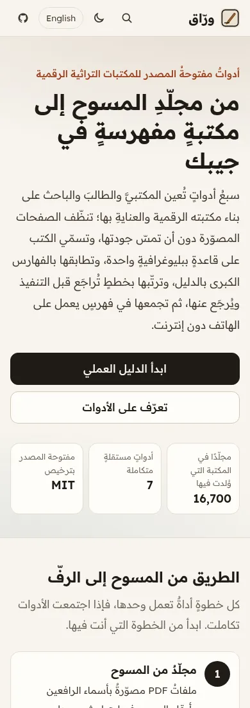
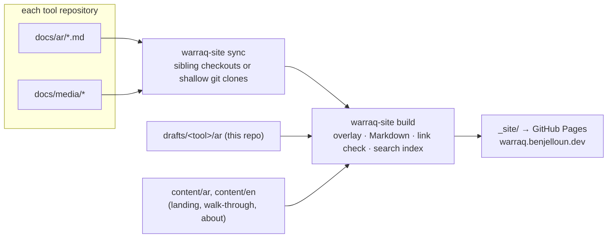
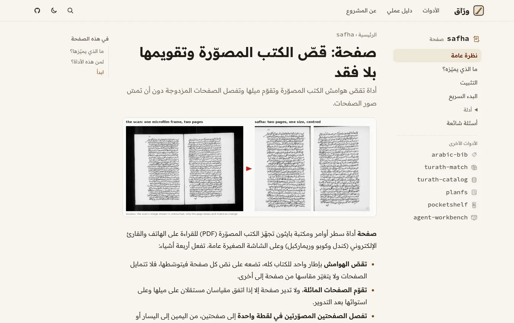
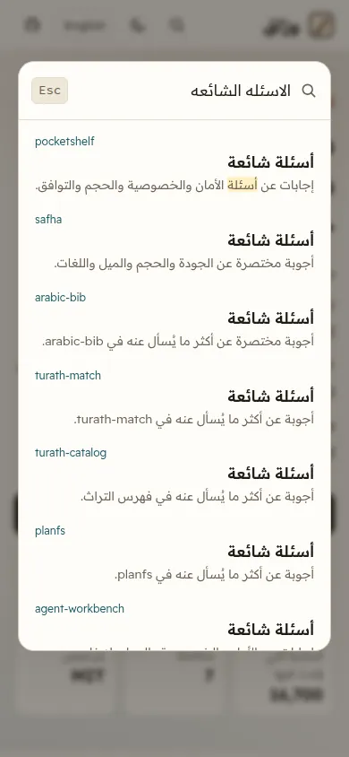

# Warraq — the Arabic documentation site

**The home of the Warraq tools, Arabic first: one site that gathers each tool's own `docs/ar/`, searches Arabic the way librarians type it, and reads well on a phone.**

[](https://github.com/kmbenjel/warraq/actions/workflows/ci.yml)
[](LICENSE)
[](LICENSE-docs.md)


Site: **https://warraq.benjelloun.dev/**

<p>


</p>

```bash
uv venv && uv pip install -e ".[dev]"
warraq-site build --sync      # gather the tools' docs from sibling checkouts, build _site/
warraq-site serve             # preview at http://127.0.0.1:8765/
```

## What it is

Warraq (الورّاق, the classical copyist and bookseller) is a family of open-source tools for building and caring for
digital heritage libraries, born from a real 16,700-volume Arabic library:

| Tool | What it does |
|---|---|
| [safha](https://github.com/kmbenjel/safha) | Lossless crop, deskew, split and page-drop for scanned PDFs |
| [arabic-bib](https://github.com/kmbenjel/arabic-bib) | Arabic bibliographic text: normalisation, names, death years, Hijri dates |
| [turath-match](https://github.com/kmbenjel/turath-match) | Catalogue reconciliation and provenance, with evidence |
| [turath-catalog](https://github.com/kmbenjel/turath-catalog) | Open bibliographic dataset: works, editions, authors, editors |
| [planfs](https://github.com/kmbenjel/planfs) | Reviewed, logged, undoable plans of file moves, renames and deletes |
| [pocketshelf](https://github.com/kmbenjel/pocketshelf) | Any folder of PDFs/EPUBs → one offline HTML catalogue |
| [agent-workbench](https://github.com/kmbenjel/agent-workbench) | Human-in-the-loop kit for long AI-agent jobs |

This repository is the documentation site for all of them: the family landing page (the path from scans to shelf,
what Warraq brings together that no single tool does, the usual way against the Warraq way), one section per tool,
and a seven-step walk-through («دليل عملي») on a small public-domain sample that ships here (`sample/warraq-sample/`).

## How the site is put together



- **Each tool owns its Arabic docs.** `sync` copies every tool's `docs/ar/`, `docs/en/` and `docs/media/` into
  `.cache/upstream/`. A page the tool has written replaces this repo's draft of the same name, so the site is complete
  while the tools are being written, and the drafts give way page by page as the real ones land.
- **Drafts are marked in front matter only** (`draft: true` becomes a `<meta name="warraq:draft">` in the head, never
  visible text); `build --no-drafts` leaves them out.
- **Links are checked.** Relative `.md` links and images are resolved from the source tree, and every root-relative
  link in the output must hit a file. `build --strict` turns any problem into a non-zero exit; CI runs it.
- **One layout for every tool** ([CONTRIBUTING.md](CONTRIBUTING.md)): `index`, `why` («ما الذي يميّزه؟», right after
  the overview), `install`, `quickstart`, `guides/*`, `faq`, and `docs/media/card.webp` for the landing card.

## Why a small generator rather than MkDocs Material

MkDocs Material was the obvious candidate: mature, good RTL support, built-in search. We chose a small generator
(about 850 lines of Python on Python-Markdown, Jinja2 and PyYAML) for four reasons:

1. **Arabic search that agrees with the tools.** The site's search must fold Arabic exactly as `arabic-bib` does
   (tashkeel and tatweel out, alef forms to ا, ة→ه, ى→ي, ؤ→و, ئ→ي, ء out, presentation forms, Persian letters,
   Eastern digits) and strip attached clitics (و ف ب ك ل ال) from the query. Material's search is built on lunr
   with per-language stemmers; matching our fold rule for rule would have meant a custom tokenizer inside a theme we
   do not control. Here the fold is one Python function and its JavaScript mirror, and a test runs both on the same
   strings (`tests/test_textnorm.py`, with Node). The index is plain JSON (about 100 KB today), fetched on first search.
2. **The sync-and-overlay model is the core need**: seven repositories own their pages, drafts fill the gaps, links
   are checked across repositories. That is a few dozen lines on top of a generator, and awkward as a plugin.
3. **The family look, phone first, RTL first.** The pages share the palette of the library index and of
   benjelloun.dev, use logical CSS properties throughout, and keep a slim sticky bar on phones; one stylesheet, no
   theme to override.
4. **Small and fast**: three runtime dependencies; the whole site (53 pages) builds in about a second.

The cost is that we own the code and have no plugin ecosystem. The content is plain Markdown with YAML front matter
and Python-Markdown admonitions, so moving to MkDocs later stays cheap.

## Typography and themes

- **Readex Pro** (text) and **Kawkab Mono** (code), both under the SIL Open Font License 1.1, self-hosted as WOFF2
  subsets (Arabic and Latin ranges; 49 KB for the variable Readex Pro, 30 KB per Kawkab weight), with no third-party
  font service. Notices and licence: `assets/fonts/OFL.txt`.
- Light and dark themes follow the system; the moon button overrides it and remembers the choice.
- Arabic body text at 17 px with a 1.9 line height; code blocks run left to right inside right-to-left pages, with a
  copy button.

<p>


</p>

## Commands

| Command | Does |
|---|---|
| `warraq-site sync [--from local\|git]` | copy each tool's docs into `.cache/upstream/` (local: sibling checkouts next to this repo; git: shallow clones) and report what is missing |
| `warraq-site build [--sync] [--no-drafts] [--strict]` | build `_site/` with sitemap, robots.txt, CNAME, 404 and `search.json` |
| `warraq-site serve [--port N]` | preview on 127.0.0.1 only |
| `scripts/screenshots.sh OUT [URL] [paths…]` | phone and desktop screenshots with headless Chrome |
| `python sample/make_sample.py OUT --preview sheet.jpg` | regenerate the walk-through sample (Pillow with libraqm) |

## The walk-through sample

`sample/warraq-sample/` holds four small PDFs typeset from classical public-domain texts (al-Nawawī's first hadith,
four lines of al-Shanfarā's *Lāmiyya*, the opening of the *Ājurrūmiyya*) and then "scanned" with the faults real
scans have: dark margins, tilted pages, a blank leaf, a two-page spread, an exact duplicate, and uploader-style file
names. `sample/make_sample.py` generates it; it is released under CC0.

## Deploying

The site is built for GitHub Pages under the custom domain `warraq.benjelloun.dev`, served from the root (the build
writes the `CNAME` file). `.github/workflows/pages.yml` builds from shallow clones of every tool and deploys; it is
started by hand (`workflow_dispatch`), and its push trigger is one uncommented line away.

## Roadmap

- English pages as the tools write `docs/en/` (the language switch appears on a page as soon as its twin exists).
- A `repository_dispatch` from each tool repository so the site rebuilds when its docs change.
- Versioned docs per tool once the tools reach 1.0.

## Contributing

See [CONTRIBUTING.md](CONTRIBUTING.md). Code is MIT; documentation text is CC BY 4.0; the sample is CC0.
