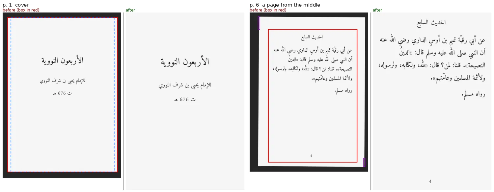

الصفحة المصوّرة يضيع نصفها على شاشة الهاتف في الهوامش السوداء وحواشي الماسح. أداة [safha](/safha/) تقصّ تلك الهوامش، لكنها لا تعيد رسم الصورة كما تفعل أكثر الأدوات؛ بل تغيّر الإطار الذي تُعرض فيه الصورة، فتبقى نقاطها كما خرجت من الماسح.

## انظر قبل أن تقصّ

ابدأ بالفحص. يقرأ هذا الأمر كل صفحةٍ ولا يكتب شيئًا:

```bash
uvx safha inspect scans/scan_0007.pdf
```

يعرض لكل صفحةٍ نوعها (غلاف أو نص)، وميلها إن كانت مائلة، والجزء الذي سيظهر منها بعد القص، ويبدأ بخلاصة ما ينوي فعله:

```text
scan_0007.pdf: 8 pages (6 text), mode CROP
  why: text 32 % larger; scanner bands; text off-centre 3.0 %
  one page size 248.6 x 372.7 pt, text 32 % larger on screen; clean margins
```

أي أن في الملف ثماني صفحات، ستٌّ منها نص، وأن الكتاب سيُقصّ بمقاسٍ واحدٍ لصفحاته كلها، فيكبر النص على الشاشة بنحو الثلث.

## قصّ الكتاب واحذف الورقة البيضاء

الصفحة الثانية ظهرُ ورقة العنوان، ولا شيء فيها. اطلب حذفها مع القص:

```bash
uvx safha crop scans/scan_0007.pdf --drop 2
```

يكتب الأمر الملف `scans/scan_0007.safha.pdf` بجانب الأصل، ولا يمسّ الأصل. ثم قصّ الكتاب الثاني:

```bash
uvx safha crop "scans/lamiya-final(2).pdf"
```

للكتاب كله مربّعٌ واحد يتوسّط نصَّ كل صفحة، فلا تقفز السطور من صفحةٍ إلى أخرى وأنت تقلّب. وإن كان في الكتاب صفحاتٌ مائلة قوّمتها الأداة حين يتّفق قياسان على ميلها، وتركت ما لم تتيقّن منه كما صُوّر وذكرته في خلاصتها.

## افصل الصفحتين

في `ajrumiya_ar.pdf` أربع لقطات، في كلٍّ منها صفحتان متقابلتان. تفصلهما الأداة من تلقاء نفسها، والخيار `--rtl` يجعل الصفحة اليمنى أولًا كما يُقرأ الكتاب العربي:

```bash
uvx safha crop scans/ajrumiya_ar.pdf --rtl
```

فيخرج الملف `scans/ajrumiya_ar.safha.pdf` في ثماني صفحاتٍ مقصوصة.

## تحقّق

قارن حجم كل ملفٍّ قبل القصّ وبعده:

```bash
ls -l scans
```

لم يزد أيُّ ملفٍّ إلا بضعة كيلوبايتات، لأن الصور لم تُرمَّز من جديد. والأصل محفوظٌ في الملف المقصوص نفسه، تستعيده منه بايتًا ببايت متى شئت:

```bash
uvx safha restore scans/scan_0007.safha.pdf -o original.pdf
cmp original.pdf scans/scan_0007.pdf
rm original.pdf
```

لا يطبع `cmp` شيئًا حين يتطابق الملفان، والسطر الأخير يحذف النسخة المستعادة بعد التحقق.

وإن أردت أن ترى الفرق بعينك فاطلب صورة «قبل | بعد» لصفحاتٍ من الكتاب:

```bash
uvx safha sheet scans/scan_0007.pdf -o sheet.png
```



!!! note "لماذا مربّعٌ واحد للكتاب؟"
    لو قُصّت كل صفحةٍ على قدر نصّها لتغيّر حجم الخط من صفحةٍ إلى أخرى على الشاشة. المربّع الواحد يحفظ للكتاب هيئته المطبوعة، ويجعل القراءة متّصلةً كما في الورق.

تفاصيل الأوامر وخياراتها في [توثيق safha](/safha/quickstart/).
