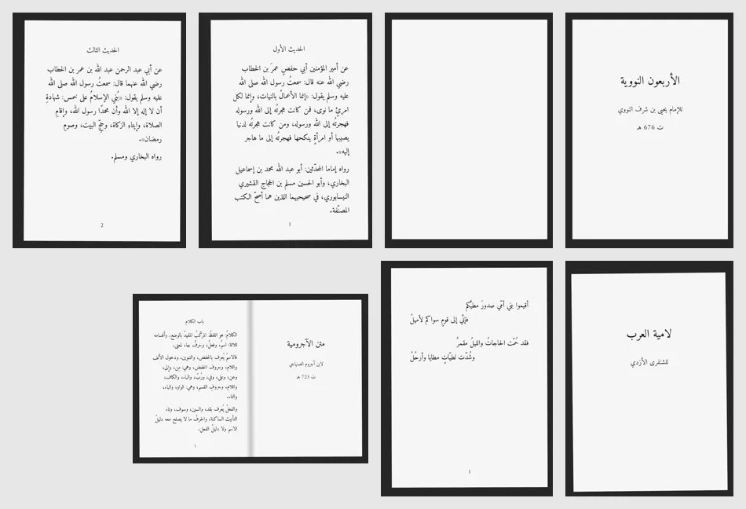

في هذا الدليل تأخذ مكتبةً صغيرةً من ثلاثة كتبٍ مصوّرة، فيها ما في المسوح الحقيقية من عيوب، وتمرّ بها على أدوات ورّاق خطوةً خطوة حتى تصير مكتبةً نظيفةَ الصفحات، صحيحةَ الأسماء، معروفةَ المصادر، لها فهرسٌ يعمل على هاتفك دون اتصال.

## ما الذي ستصنعه

| الخطوة | الأداة | ما يتغيّر |
|---|---|---|
| [تجهيز العيّنة](01-sample.md) | — | مجلدٌ فيه أربعة ملفات PDF وجدولُ فهرسة |
| [تنظيف الصفحات](02-clean.md) | `safha` | تُقصّ الهوامش السوداء، وتُفصل الصفحتان المصوّرتان معًا، وتُحذف الورقة البيضاء |
| [التسمية](03-name.md) | `arabic-bib` | يأخذ كل كتابٍ اسمه الكامل على القاعدة |
| [المطابقة وكشف المكرّر](04-match.md) | `turath-match` | يثبت أن ملفين نسخةٌ واحدة، وتُعرف الأعمال في الفهارس |
| [الترتيب بخطة](05-plan.md) | `planfs` | تُطبَّق التسميات والحذف بخطةٍ مسجّلةٍ يمكن التراجع عنها |
| [فهرسٌ على الهاتف](06-catalog.md) | `pocketshelf` | ملف HTML واحد تفتحه في متصفح الهاتف |
| [بعد الدليل](07-next.md) | `agent-workbench` | كيف تكبر من ثلاثة كتب إلى آلاف |

## ما تحتاج إليه

- حاسوبٌ عليه Python 3.10 أو أحدث (لينكس أو ماك أو ويندوز).
- أداة [uv](https://docs.astral.sh/uv/) لتشغيل الأدوات دون تثبيتٍ دائم، أو `pipx` إن كنت تفضّله.
- نحو عشرين دقيقة.

لا تحتاج إلى هاتفٍ لتتمّ الدليل؛ فالخطوة الأخيرة تُفتح في أي متصفح، ثم تنقل الملف إلى الهاتف متى شئت.

!!! tip "طريقتان لتشغيل الأدوات"
    أوامر الدليل مكتوبةٌ بصيغة `uvx safha …`، فيجلب `uvx` الأداة عند أول تشغيلٍ ولا يثبّت شيئًا في نظامك. وإن أردت أحدث ما في مستودع الأداة فاذكر المستودع: `uvx --from git+https://github.com/kmbenjel/safha safha …`. ومن ثبّت الأداة بالأمر `pipx install safha` يكتب الأمر دون `uvx`.

!!! note "عن العيّنة"
    نصوص العيّنة من الملك العام: ستة أحاديث من «الأربعين النووية» للنووي (ت 676 هـ)، واثنا عشر بيتًا من «لامية العرب» للشنفرى، وأبوابٌ من أول «متن الآجرومية» لابن آجروم (ت 723 هـ). صُفّت النصوص وصُوّرت ببرنامجٍ صغيرٍ في مستودع ورّاق، فلا حقوق فيها لأحد، وهي متاحةٌ بترخيص CC0.

